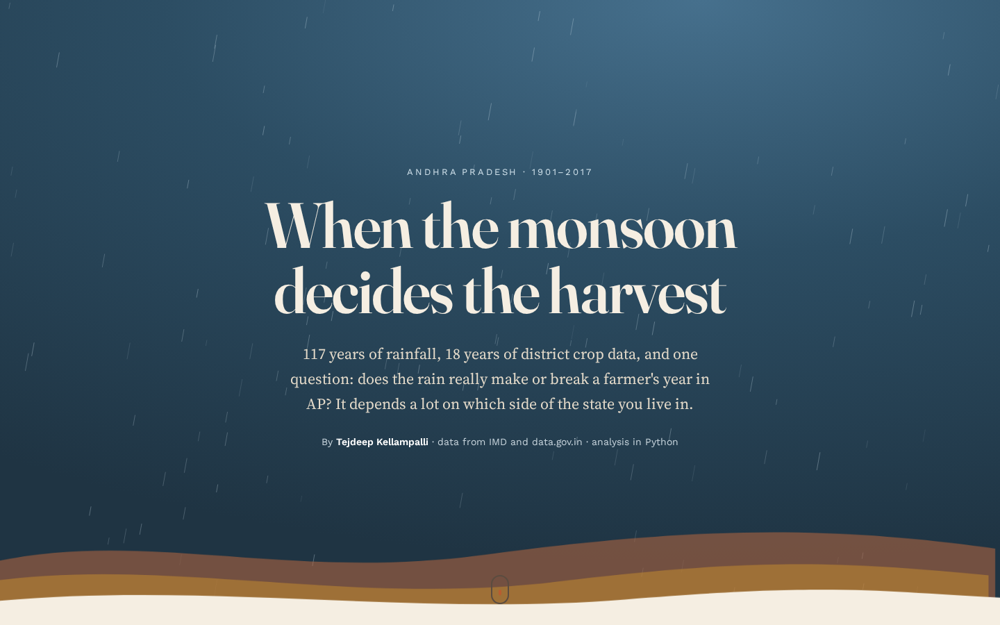
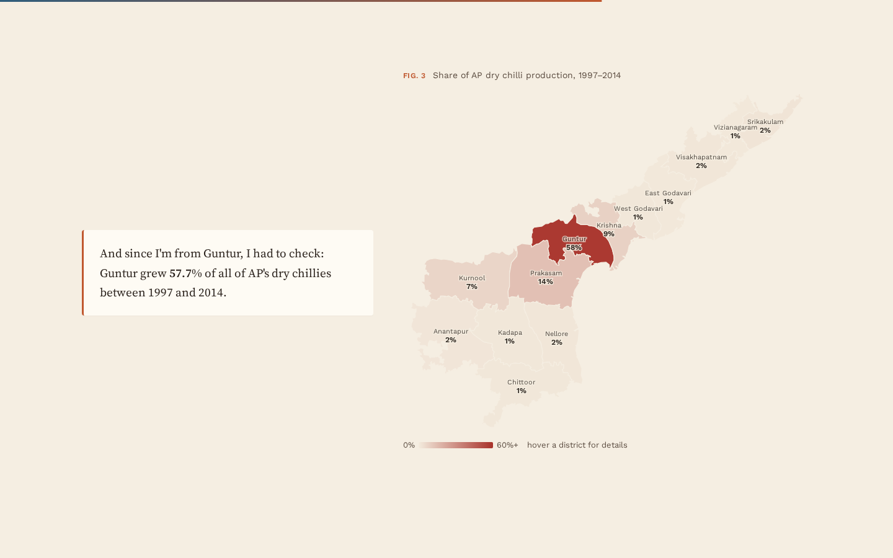
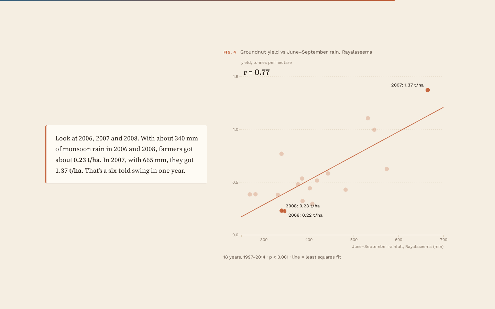
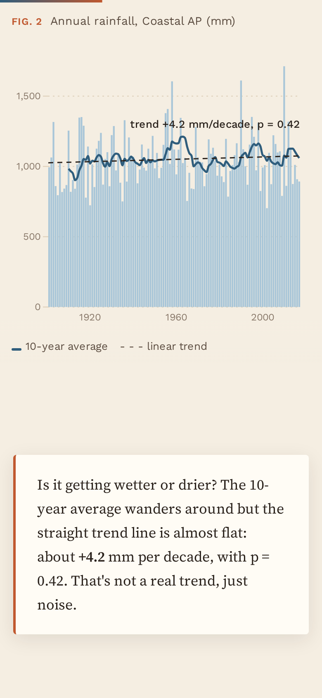

# Andhra Pradesh Rainfall and Crop Production (EDA)

Exploratory data analysis of 117 years of rainfall (1901-2017) and 18 years of district crop data (1997-2014)
for Andhra Pradesh, done in Python (pandas, matplotlib, seaborn, scipy).

**Live data story:** https://tejdeep-ap-rainfall.netlify.app
**Notebook:** [notebooks/ap_rainfall_crop_eda.ipynb](notebooks/ap_rainfall_crop_eda.ipynb) (also on the site as [notebook.html](https://tejdeep-ap-rainfall.netlify.app/notebook.html))



## Problem

In AP, farming conversations always come back to the monsoon. I wanted to check with data:

1. How much rain do Coastal Andhra and Rayalaseema get, and in which months?
2. Is rainfall really changing over the years? How often do drought years happen?
3. Which crops and districts produce the most?
4. Does rainfall actually change crop yield, or does irrigation matter more?

## Data

| Dataset | Source | Rows used |
|---|---|---|
| Sub-divisional monthly rainfall, 1901-2017 | India Meteorological Department, published on [data.gov.in](https://www.data.gov.in/resource/sub-divisional-monthly-rainfall-1901-2017) (Govt. Open Data License - India) | 234 (2 sub-divisions x 117 years) |
| District-wise season-wise crop production, 1997-2014 | Ministry of Agriculture & Farmers Welfare via [data.gov.in](https://www.data.gov.in/catalog/district-wise-season-wise-crop-production-statistics-0), also mirrored on [Kaggle](https://www.kaggle.com/datasets/abhinand05/crop-production-in-india) | 9,500 AP rows |

District boundaries for the map: Census 2011 districts by the [DataMeet India community](https://github.com/datameet/maps), CC BY 4.0.

The rainfall CSV is in `data/raw/`. The full all-India crop file is about 15 MB, so only the AP part is in the repo
(`data/ap_crop_production.csv`, made by `scripts/prepare_crop_data.py`).

## Approach

- **Cleaning:** no missing rainfall values for AP. In the crop data I found 61 "Whole Year" rows that were just
  Kharif + Rabi added together (mostly 2013-2014), which made 2014 rice production look double. Removed them,
  plus 67 rows with missing production.
- **Rainfall:** monthly averages, share of SW monsoon (Jun-Sep) vs NE monsoon (Oct-Dec), 10-year rolling average,
  linear trend with p-value, and IMD-style deficient/excess years (more than 20% below/above normal).
- **Crops:** area by crop, district share of rice and chilli production.
- **Rain vs yield:** Pearson correlation between yearly yield and rainfall for rain-fed groundnut (Rayalaseema)
  and irrigated rice (coastal districts).

## Key findings

- Coastal AP gets **1050 mm** a year on average, Rayalaseema only **765 mm**.
- The wettest month in Coastal AP is **October** (184 mm), not July. Rayalaseema gets **35%** of its rain from the
  NE monsoon (Oct-Dec), so June-September alone doesn't tell you if it was a good year.
- No real long-term trend: about +4 mm per decade, but p > 0.25, so it's not significant. Year-to-year variation
  (about 18-20%) is much bigger.
- Rayalaseema had **18 deficient years** out of 117, Coastal AP had 12. Driest year for Coastal AP: 2002 (703 mm).
- Rice and groundnut take up most of the farmland. The Godavari districts, Krishna and Guntur grow about
  **63% of AP's rice**. **Guntur alone grows 57.7% of AP's dry chillies.**
- **Groundnut yield in Rayalaseema follows the monsoon closely (r = 0.77, p < 0.001).** 2007 (665 mm) gave
  1.37 t/ha, while 2006 and 2008 (about 340 mm) gave about 0.23 t/ha, a 6x swing.
- **Coastal rice yield has no real link with rainfall (r = -0.27, not significant)** because the delta is canal irrigated.

So irrigation is what separates the two regions. Rain-fed Rayalaseema carries the full risk of a bad monsoon.

| Monthly rainfall | Deficient years per decade |
|---|---|
|  |  |

| Long-term trend | District share |
|---|---|
|  |  |

## The web version (data story)

Besides the notebook, I wanted a version that someone who doesn't read code can follow, like the scrolling
articles newspapers make. It's in `docs/` and is just HTML, CSS and D3, no framework.

- As you scroll, the text cards on the left move the chart on the right through steps: the monthly pattern,
  117 years of annual rain with the trend line, deficient years, a district map and rain vs yield.
- The **district map** is a choropleth of the 13 AP districts (rice, groundnut and chilli share). Boundaries are
  Census 2011 districts from DataMeet (CC BY 4.0), cut down to today's AP and simplified by
  `scripts/build_district_map.py`.
- The charts read `docs/data/story.json`, which `scripts/build_story_data.py` makes from the same CSVs using the
  same steps as the notebook, so the numbers on the site and in the notebook are the same.
- On phones the chart sticks to the top of the screen and the text scrolls over it. Animations are switched off
  if the phone/PC has "reduce motion" turned on.

| District map | Rain vs groundnut yield |
|---|---|
|  |  |



## How to run

```bash
git clone https://github.com/Tejdeep-67/ap-rainfall-crop-analysis.git
cd ap-rainfall-crop-analysis
pip install -r requirements.txt
jupyter notebook notebooks/ap_rainfall_crop_eda.ipynb
```

To rebuild the AP crop file from scratch, download `crop_production.csv` from the Kaggle link above into
`data/raw/` and run `python scripts/prepare_crop_data.py`.

To rebuild the web version's data and view it locally:

```bash
python scripts/build_story_data.py      # docs/data/story.json
python scripts/build_district_map.py    # docs/data/ap_districts.geojson (downloads the boundaries once)
cd docs && python -m http.server 8000   # open http://localhost:8000
```

The site is deployed on Netlify straight from the `docs/` folder (see `netlify.toml`), no build step.

## Limitations

- Crop data stops at 2014 and covers only 18 years, so the correlations are based on 18 points.
- Rainfall is at sub-division level, not district level.
- Correlation is not causation. Prices, pests and seed quality also affect yield.
